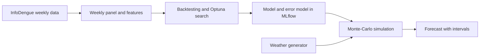

# Dengue epidemic prediction

Probabilistic forecasts of weekly dengue incidence in four Brazilian state capitals. A
machine-learning model of the epidemic's week-to-week growth is trained with automated
backtesting and hyperparameter search, and Monte-Carlo simulation over weather scenarios and
model errors turns it into forecasts with calibrated uncertainty.

## The problem

Dengue is transmitted by *Aedes* mosquitoes, whose abundance and infectivity depend on
temperature and humidity. Brazil reports hundreds of thousands to millions of cases per year in
seasonal epidemics of very different size; 2024 was the largest on record. Health authorities
need to know early how the coming weeks and months may develop, and how uncertain that
expectation is, to plan hospital capacity and vector control.

Forecasting weekly incidence is harder than it looks:

- **Strong persistence.** Next week's incidence is very close to this week's; simply repeating
  the last value already explains 97 % of the variance. A useful model has to beat this baseline,
  not the mean.
- **Unknown future weather.** Weather drives transmission, but it is not known beyond a few days.
- **Changing regimes.** Epidemics larger than any seen before must be forecastable.
- **Noisy reporting.** In weeks with few cases, counting noise dominates the weekly changes.

The data are the weekly records of [InfoDengue](https://info.dengue.mat.br) for Belo Horizonte,
Rio de Janeiro, São Paulo and Vitória from 2010 to 2025: estimated incidence per 100 000
inhabitants and weekly minimum, mean and maximum of temperature and relative humidity.

## What this repository does



1. **Data preparation.** The raw records become a validated weekly panel per city (epidemiological
   week calendar, repair of a misdated week, reporting gaps treated as missing) with lagged
   features. Everything runs at the native weekly resolution.
2. **Automated model training.** A random forest or XGBoost model, chosen in the settings,
   learns the weekly change of the log incidence. Optuna searches its hyperparameters on
   expanding-window backtesting folds (two-year validation windows), scored by the skill relative
   to persistence. The last two years are held out for the final test.
3. **Experiment tracking.** Every run is logged to MLflow with its dataset, parameters, backtest and
   test metrics, diagnostic plots and the fitted error model; the model is registered for the
   simulation.
4. **Monte-Carlo simulation.** The model is rolled forward week by week for up to a year, with
   weather drawn from a climate model, a model error estimated from out-of-sample residuals, and an
   uncertain starting value. The samples give the expected incidence with prediction intervals,
   also converted into weekly case numbers.
5. **Calibration check.** Forecasts started in the hold-out years show whether the intervals
   contain as many observations as they claim.

## Prediction model

Let $x_{c,t} = \ln p_{c,t}$ be the log incidence of city $c$ in epidemiological week $t$,
$\mathbf{w}_{c,t} \in \mathbb{R}^6$ the weekly weather and $s_t \in \lbrace 1, \dots, 53 \rbrace$
the week of the year. The model predicts the weekly change of the log incidence (the epidemic's
growth rate) from the current state, $L$ lagged weeks and the weather:

$$
x_{c,t+1} = x_{c,t} + f\big(s_t,\ c,\ x_{c,t}, \dots, x_{c,t-L},\ \mathbf{w}_{c,t+1}, \mathbf{w}_{c,t}, \dots, \mathbf{w}_{c,t-L}\big) + \varepsilon_{c,t+1}
$$

Predicting the change instead of the level builds persistence into the model ($f \equiv 0$) and
lets tree ensembles, which cannot extrapolate, forecast epidemics larger than any in their training
data. $f$ is a random forest of $B$ regression trees $T_b$,

$$
\hat f(\mathbf{z}) = \frac{1}{B} \sum_{b=1}^{B} T_b(\mathbf{z}),
$$

trained on the targets $\Delta_{c,t+1} = x_{c,t+1} - x_{c,t}$ with the observed weather
$\mathbf{w}_{c,t+1}$, i.e. as a model of the epidemic conditional on the weather.

Models are scored by their skill relative to persistence ($\hat\Delta = 0$),

$$
S = 1 - \frac{\sum_i \big(\Delta_i - \hat\Delta_i\big)^2}{\sum_i \Delta_i^2},
$$

and the hyperparameters $\theta$ maximise the skill of the out-of-fold predictions of $K$
backtesting folds, each trained on all years before its validation window $V_k$:

$$
\hat\theta = \arg\max_\theta \left[ 1 - \frac{\sum_{k=1}^{K} \sum_{i \in V_k} \big(\Delta_i - \hat\Delta_i^{(k,\theta)}\big)^2}{\sum_{k=1}^{K} \sum_{i \in V_k} \Delta_i^2} \right]
$$

## Climate model

Future weather is drawn from a weekly climatology. For city $c$ and week of the year $s$, the
mean vector and covariance matrix pool the development years' weather within $h = 2$ weeks of $s$
(circularly across the turn of the year):

$$
\mathcal{W}_{c,s} = \lbrace \mathbf{w}_{c,t} : d(s_t, s) \le h \rbrace, \qquad
\boldsymbol{\mu}_{c,s} = \overline{\mathcal{W}_{c,s}}, \qquad
\boldsymbol{\Sigma}_{c,s} = \operatorname{Cov}\big(\mathcal{W}_{c,s}\big)
$$

$$
\mathbf{w}_{c,t} \sim \mathcal{N}\big(\boldsymbol{\mu}_{c,s_t},\ \boldsymbol{\Sigma}_{c,s_t}\big)
$$

## Error model

The out-of-fold residuals of the backtest show counting noise in weeks with few cases and a
persistent error in large epidemics. Both are captured by a small state-space model: the reported
log incidence $y_t$ is the true log incidence $x_t$ plus counting noise, and the true log incidence
follows the model up to an autoregressive process error,

$$
y_t = x_t + \nu_t, \quad \nu_t \sim \mathcal{N}\big(0,\ \tau^2 / n_t\big), \qquad
\varepsilon_{t+1} = \eta_{t+1} = \phi\, \eta_t + \xi_{t+1}, \quad \xi_{t+1} \sim \mathcal{N}\big(0,\ \sigma_\eta^2 (1 - \phi^2)\big),
$$

where $n_t$ is the number of weekly cases. $\sigma_\eta$, $\phi$ and $\tau^2$ are estimated from the
residuals by the method of moments.

## Monte-Carlo sampling

From the last observed week $t_0$, each of the $N$ samples $i$ draws an initial state and is
propagated $H$ weeks ahead, feeding every prediction back as the next state:

$$
x^{(i)}_{t_0} = y^\text{obs}_{t_0} + \delta^{(i)} - \nu^{(i)}_{t_0}, \qquad
\delta^{(i)} \sim \mathcal{N}\big(0, \sigma_0^2\big), \qquad
\eta^{(i)}_{t_0} \sim \mathcal{N}\big(0, \sigma_\eta^2\big)
$$

```math
\begin{aligned}
\mathbf{w}^{(i)}_{t+1} &\sim \mathcal{N}\big(\boldsymbol{\mu}_{c,s_{t+1}},\ \boldsymbol{\Sigma}_{c,s_{t+1}}\big) \\
\eta^{(i)}_{t+1} &= \phi\, \eta^{(i)}_t + \xi^{(i)}_{t+1} \\
x^{(i)}_{t+1} &= x^{(i)}_t + \hat f\big(s_t,\ c,\ x^{(i)}_t, \dots, \mathbf{w}^{(i)}_{t+1}, \mathbf{w}^{(i)}_t, \dots\big) + \eta^{(i)}_{t+1} \\
y^{(i)}_{t+1} &= x^{(i)}_{t+1} + \nu^{(i)}_{t+1}
\end{aligned}
\qquad t = t_0, \dots, t_0 + H - 1
```

The forecast for week $t$ is the empirical distribution of the samples $\lbrace y^{(i)}_t \rbrace$:
its geometric mean $\exp\big(\frac{1}{N}\sum_i y^{(i)}_t\big)$ and quantiles, e.g. the 95 % interval
between the 2.5 % and 97.5 % quantiles. All samples are simulated together, so one week costs a
single model call.

In an example run, 95 % of the observations of 2024–2025 (forecast horizons of 1 to 26 weeks) fell
inside the 95 % intervals, compared with 28 % without the error model. Details are in
[documentation/methodology.md](documentation/methodology.md).

## Repository structure

```
utils/               data preparation, epi-week calendar, features, climate tables, plots, pipeline settings
model_synthesis/     backtesting, skill score, Optuna search, random forest and XGBoost trainers
model_definition/    error model and Monte-Carlo simulation engine
model_validation/    Monte-Carlo forecast, one-step check, calibration of the intervals
data_preparation/    scripts writing intermediate tables
data_analysis/       exploratory analysis notebook
documentation/       methodology in detail
tests/               unit tests on synthetic data
```

## Getting started

Python 3.12. Install the pinned dependencies and the project:

```bash
pip install -r requirements.txt
pip install -e ".[dev]"
```

The data are not part of the repository. Place the InfoDengue weekly records of the four cities
in `data/raw/infodengue_capitals_subsetBR.csv`, with a `city_name` column added
([data dictionary](.github/data_set_legend.md)). Then, from the project root:

```bash
python utils/run_complete_pipeline.py              # features, backtesting, Optuna search, MLflow registration
python model_validation/monte_carlo_simulation.py  # Monte-Carlo forecasts, figures and weekly case table
python model_validation/calibration.py             # coverage of the prediction intervals
python -m pytest                                   # unit tests
mlflow ui --backend-store-uri sqlite:///mlflow.db  # browse runs, metrics and plots
```

The model type (random forest or XGBoost), the number of lagged weeks, the backtesting windows and
the number of Optuna trials are set in [`utils/run_complete_pipeline.py`](utils/run_complete_pipeline.py).

## License

[MIT](LICENSE)
